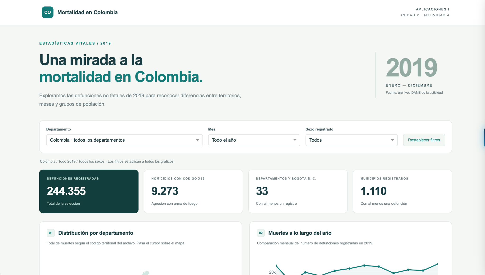
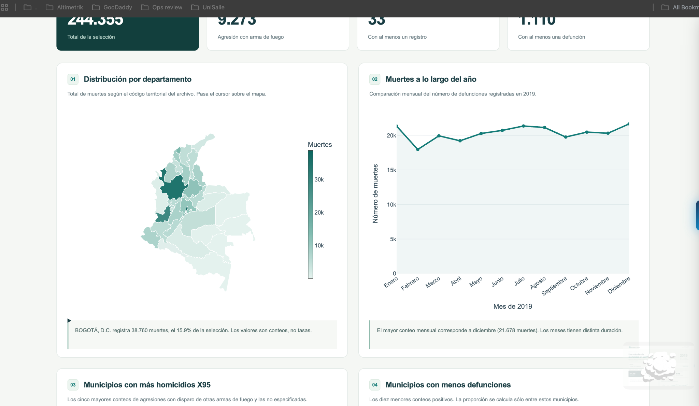
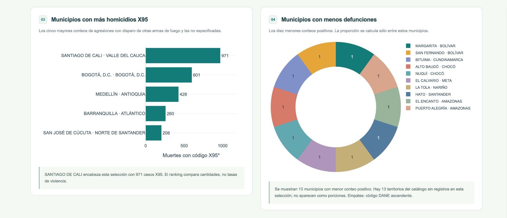
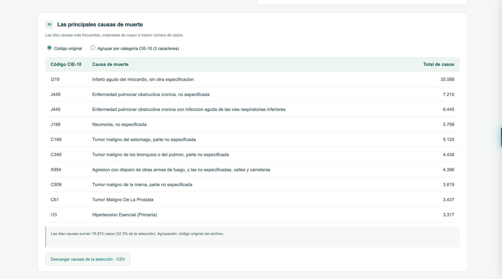
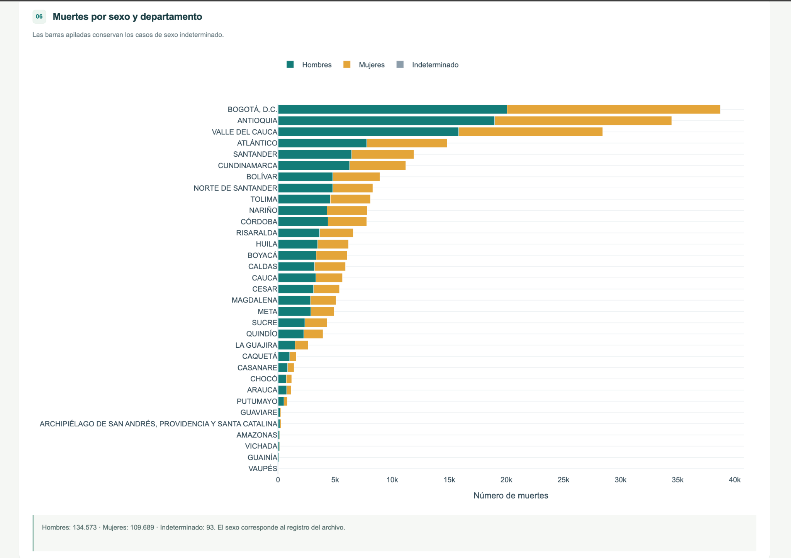
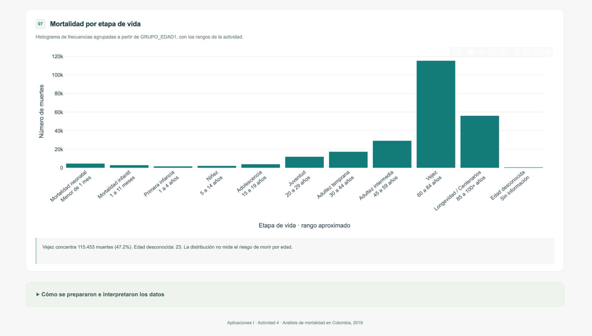

# Mortalidad en Colombia, 2019

**Aplicaciones I · Unidad 2 · Actividad 4 · 2026-2**

**Integrante:** Sebastian Contreras Gomez

- [Aplicación en Render](https://mortalidad-colombia-dnrc.onrender.com/)
- [Repositorio en GitHub](https://github.com/SebasCoGo/mortalidad-colombia)

## Introducción

Este proyecto presenta una aplicación web para analizar las defunciones no fetales registradas en Colombia durante 2019. Se utilizaron los archivos de mortalidad, causas de muerte y división territorial entregados en la actividad. La base contiene 244.355 registros.



## Objetivo

Analizar la distribución de las muertes por departamento, mes, causa, sexo y grupo de edad mediante gráficos interactivos que permitan explorar los datos de 2019.

## Estructura del proyecto

| Archivo o carpeta | Contenido |
| --- | --- |
| `app.py` | Interfaz de la aplicación y actualización de los gráficos |
| `src/` | Funciones de análisis, gráficos y categorías de edad |
| `assets/` | Estilos de la aplicación |
| `data/raw/` | Los tres archivos Excel originales |
| `data/` | Datos procesados, catálogos y mapa departamental |
| `docs/capturas/` | Capturas de la aplicación desplegada |
| `scripts/prepare_data.py` | Procesamiento de los archivos originales |
| `tests/` | Pruebas de datos y funcionamiento |
| `requirements.txt` | Librerías necesarias para ejecutar la aplicación |
| `render.yaml` | Configuración del servicio en Render |

## Requisitos

Python 3.12 y las siguientes librerías:

| Librería | Versión |
| --- | --- |
| Dash | 3.2.0 |
| Plotly | 6.3.0 |
| pandas | 2.3.2 |
| openpyxl | 3.1.5 |
| Gunicorn | 23.0.0 |

## Software

Se utilizaron Python para el procesamiento, pandas para organizar los datos, Dash para la aplicación y Plotly para las visualizaciones. El proyecto se publicó en GitHub y se desplegó en Render. La presentación se definió con CSS.

## Instalación

Desde una terminal en macOS o Linux:

```bash
git clone https://github.com/SebasCoGo/mortalidad-colombia.git
cd mortalidad-colombia
python3.12 -m venv .venv
source .venv/bin/activate
python -m pip install -r requirements.txt
python app.py
```

Abrir http://localhost:8050. En Windows, crear el entorno con `py -3.12 -m venv .venv` y activarlo con `.venv\Scripts\activate`.

Los datos procesados están incluidos. Para volver a obtenerlos desde los Excel, ejecutar `python scripts/prepare_data.py`.

## Despliegue en Render

La aplicación está publicada como un servicio web conectado al repositorio de GitHub. Para reproducir el despliegue, seleccionar Python como entorno de ejecución y configurar estos comandos:

**Instalación de dependencias:**

```bash
pip install -r requirements.txt
```

**Inicio del servicio:**

```bash
gunicorn app:server --bind 0.0.0.0:$PORT --workers 1 --threads 4 --timeout 120
```

El archivo `.python-version` indica Python 3.12. El objeto `server` de `app.py` permite ejecutar Dash con Gunicorn.

## Visualizaciones y resultados

Los resultados descritos corresponden al total nacional, sin filtros. Los controles de departamento, mes y sexo actualizan los gráficos y la tabla. También se pueden descargar las causas de la selección en CSV.

### 1. Mapa de muertes por departamento

Bogotá D. C. registra 38.760 defunciones, Antioquia 34.473 y Valle del Cauca 28.443. Estos tres territorios concentran cerca del 41,6 % de los registros. El mapa permite comparar las cantidades por departamento.

### 2. Muertes por mes

Diciembre presenta el mayor número de muertes, con 21.678, y febrero el menor, con 17.974. Se observan variaciones durante el año; al compararlas se debe tener en cuenta que los meses tienen distinta duración.



### 3. Cinco municipios con más casos X95

| Municipio | Casos |
| --- | ---: |
| Santiago de Cali | 971 |
| Bogotá D. C. | 601 |
| Medellín | 428 |
| Barranquilla | 260 |
| San José de Cúcuta | 206 |

Santiago de Cali tiene el mayor conteo. Para este gráfico se seleccionaron los códigos que comienzan por X95, incluidos sus subcódigos. En toda la base suman 9.273 casos; representan un subconjunto de los homicidios.

### 4. Diez territorios con menos defunciones

Margarita, San Fernando, Bituima, Alto Baudó, Nuquí, El Calvario, La Tola, Hato, El Encanto y Puerto Alegría registran una defunción cada uno. Las porciones del gráfico son iguales: cada territorio representa el 10 % del total de esos diez.

Se consideraron los menores conteos positivos. Los empates se resolvieron por código DANE y se excluyeron los 13 territorios del catálogo que no tienen registros en la base.



### 5. Diez principales causas de muerte

El código I219, infarto agudo del miocardio sin otra especificación, ocupa el primer lugar con 35.088 casos. Le siguen J449, enfermedad pulmonar obstructiva crónica no especificada, con 7.210, y J440, enfermedad pulmonar obstructiva crónica con infección aguda de las vías respiratorias inferiores, con 6.445.

La tabla muestra las diez causas con su código, nombre y número de casos. La opción de tres caracteres permite reunir los subcódigos de una misma categoría CIE-10.



### 6. Muertes por sexo y departamento

Se registran 134.573 hombres, 109.689 mujeres y 93 casos de sexo indeterminado. Los hombres representan aproximadamente el 55,1 % del total. Las barras apiladas permiten comparar esta distribución entre departamentos.



### 7. Distribución por grupo de edad

El grupo de 60 a 84 años concentra 115.453 muertes, equivalentes al 47,2 % del total. Le sigue el grupo de 85 a 100+ años, con 56.061. Hay 23 registros con edad desconocida. Se utilizaron las categorías de `GRUPO_EDAD1` indicadas en la actividad.



## Criterios del análisis

Cada fila del archivo original se contó como una defunción. Los códigos DANE se conservaron como texto para mantener los ceros iniciales y se cruzaron con Divipola. Se conservaron los casos de sexo indeterminado y edad desconocida.

Los resultados son cantidades de muertes. Para calcular tasas por habitante se necesitarían datos de población. Por eso, un conteo menor no permite concluir que un territorio tenga menor riesgo de mortalidad. El nivel territorial utilizado es el del catálogo Divipola, que también contiene áreas no municipalizadas.

## Fuentes

- Archivos de la actividad: `Anexo1.NoFetal2019_CE_15-03-23.xlsx`, `Anexo2.CodigosDeMuerte_CE_15-03-23.xlsx` y `Divipola_CE_.xlsx`.
- RED6 de la Unidad 2, apartados 3.3 y 3.6.
- [DANE: defunciones no fetales de 2019](https://www.dane.gov.co/index.php/estadisticas-por-tema/salud/nacimientos-y-defunciones/defunciones-no-fetales/defunciones-no-fetales-2019).
- [Cartografía departamental MGN 2018 simplificada](https://github.com/caticoa3/colombia_mapa), elaborada a partir de información del DANE.
